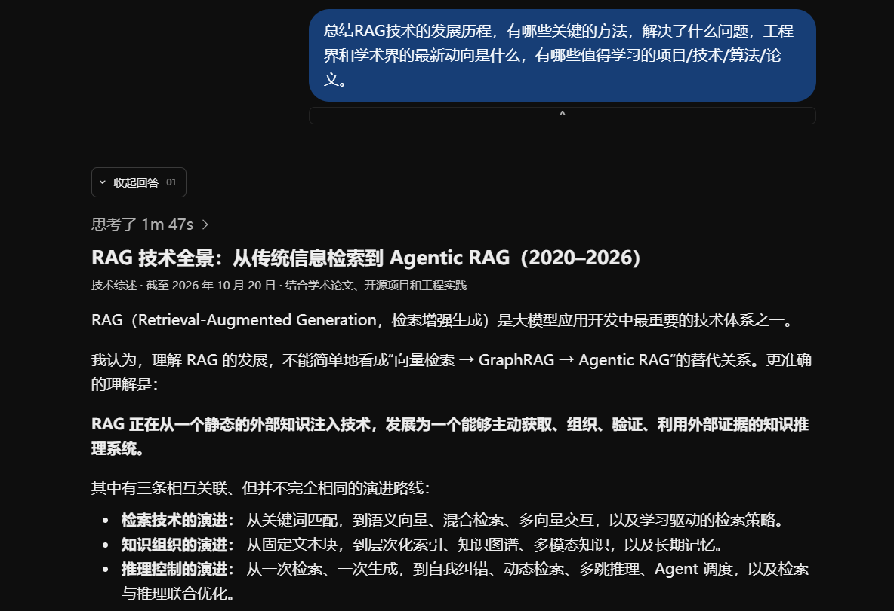
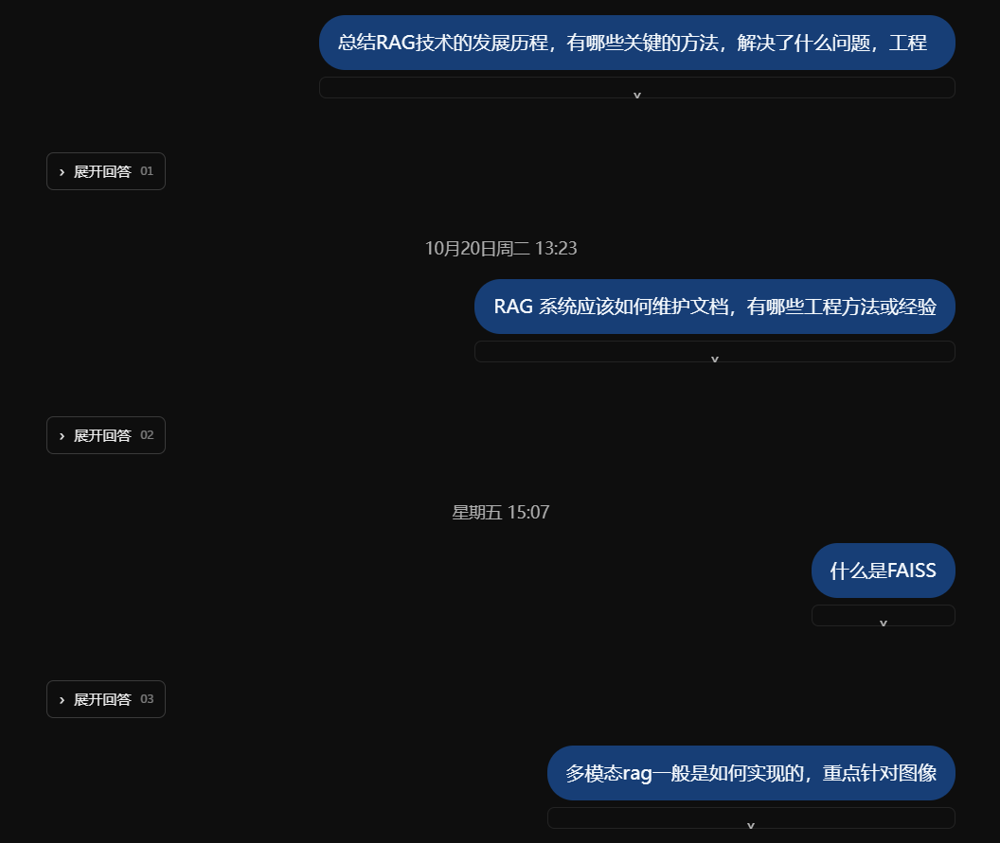

# ChatFolder

一款 Chrome 浏览器扩展，收起 ChatGPT 的长篇回答和用户输入，让长对话更易浏览。

## 功能

- **回答折叠**：逐条展开或收起回答，支持自动收起新回答及一键全部收起 / 展开。
- **输入折叠**：每条已发送的用户消息下方显示折叠拉手，点击后只保留指定行数，默认为 1 行。首次默认完整显示，之后恢复已保存的状态，不影响未发送的草稿。
- **独立控制**：回答与输入折叠可分别启停，并分别执行批量操作。
- **记住折叠状态**：按会话保存每条回答和用户输入的展开 / 收起状态，刷新或再次打开会话时自动恢复。记录只保存在当前 Chrome 配置中，不上传、不跨设备同步。
- **会话索引**：按消息 ID 去重记住已识别的问答，滚出屏幕后不会减少计数；支持校验完整会话目录。
- **本地处理**：不上传聊天内容，支持浅色与深色界面。

目前支持 ChatGPT（`chatgpt.com`、`chat.openai.com`），预留 Gemini、DeepSeek 等厂商的适配接口。

## 效果对比

### 折叠前



### 折叠后



## 安装

需要 Chrome 和 Node.js 22.12 或更高版本。

1. 克隆项目并编译：

   ```sh
   git clone https://github.com/Sw1PerGoSwiPinG/ChatFolder.git
   cd ChatFolder
   npm ci
   npm run build
   ```

2. 在 Chrome 地址栏打开 `chrome://extensions`，开启右上角的「开发者模式」。
3. 点击「加载已解压的扩展程序」，选择项目根目录（包含 `manifest.json` 的目录）。
4. 打开或刷新 ChatGPT 页面，点击 Chrome 工具栏中的 ChatFolder 图标。

## 使用

- **管理回答**：开启「折叠 AI 回答」，点击页面中的回答按钮逐条展开 / 收起，或在插件中点击「全部收起 / 全部展开」。开启「自动收起新回答」后，新回答会自动收起。
- **管理输入**：开启「折叠用户输入」，设置「收起后显示」的行数。点击消息下方的拉手即可收起 / 展开；下方的「全部收起 / 全部展开」只作用于用户输入。短消息也会显示拉手，收起后不会强行补足行数。
- **状态恢复**：逐条和批量操作均会记住。已有记录优先于默认设置，暂停折叠不会删除记录；没有稳定会话 / 消息 ID 的内容仅在当前页面记忆。卸载扩展会清除本地记录。
- **会话数量与校验**：首次访问显示“已识别”数量，重新打开时可复用本地缓存，不会把屏幕中的 1～2 条误当成整个会话。点击“校验会话”会临时滚动遍历当前会话，完成后更新数量、顺序和分支；滚动、按 Esc 或点击“取消”可中止。扫描不完整时不会删除缓存，也不会声称数量完整。
- **批量操作范围**：完整校验后，“全部收起 / 全部展开”覆盖目录中的消息，包括未挂载到页面的消息；未校验时按钮显示“收起已识别 / 展开已识别”。新消息继续遵循默认设置。校验结果超过 5 分钟会标为缓存，建议在编辑问题、切换分支或删除消息后重新校验。
- **更新插件**：拉取最新代码后运行 `npm run build`，在扩展管理页重新加载 ChatFolder，再刷新 ChatGPT 页面。刷新前请保存未发送的草稿。

开发与测试说明见 [DEVELOPMENT.md](DEVELOPMENT.md)。
