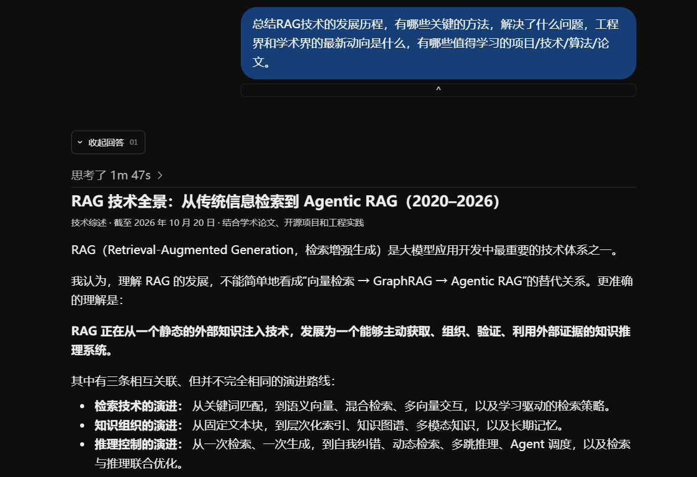
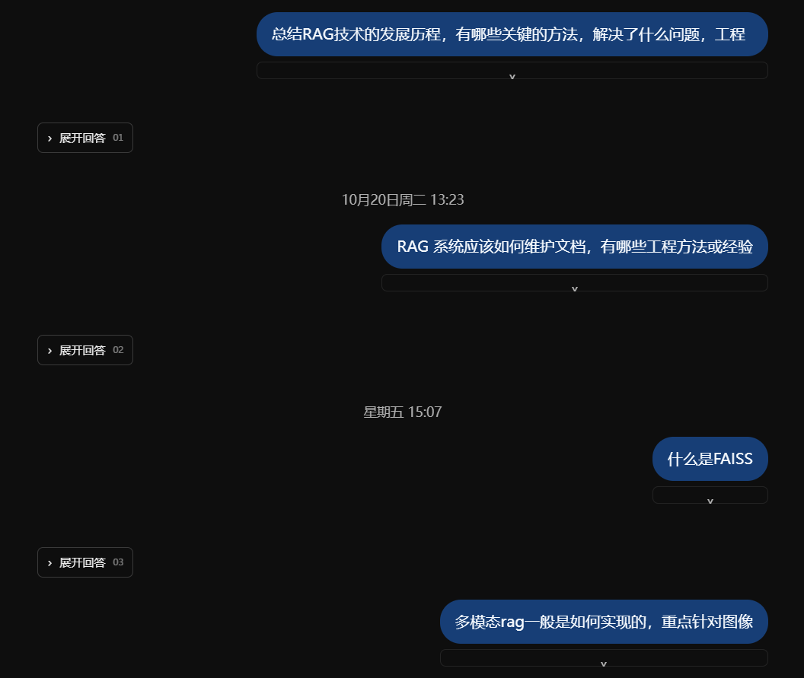

# ChatFolder

一款 Chrome 浏览器扩展，将 ChatGPT 的长篇回答收起来，让对话更容易浏览。

- 保留用户问题，按需展开或收起每次回答。
- 支持全部展开、全部收起，以及自动收起新回答。
- 仅在本地处理，不上传聊天内容。

目前支持 ChatGPT，预留 Gemini、DeepSeek 等厂商的适配接口。

## 使用前

> 配图待补充：回答全部展开的对话页面。

<!-- 使用前配图位置： -->

## 使用后

> 配图待补充：仅显示用户问题和回答展开按钮的页面。

<!-- 使用后配图位置： -->
